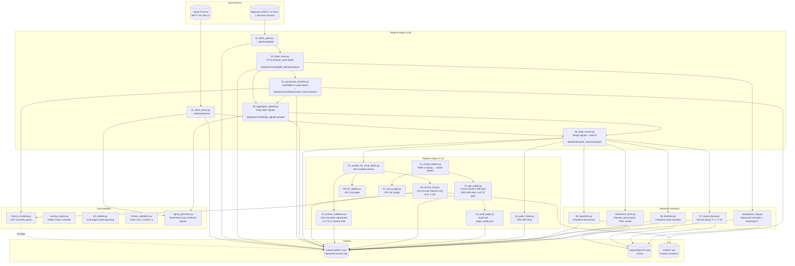

# Architecture Diagram

---

## Plain-English Summary (for non-experts)

**What this project does:**
We tested whether news articles about NIFTY 50 companies can predict stock returns the next day. We looked at two ideas:
1. **Source matters**: "Real" journalism (editorial) might be more informative than corporate press releases (sponsored/PR).
2. **Timing matters**: News published while the market is closed (overnight) might be more valuable because it hasn't been priced in yet.

**What we found (the honest answer):**
**Nothing works.** After rigorous testing with real data, proper forward-looking evaluation (no peeking at same-day returns), and statistical corrections for multiple testing — **none of the signals produce statistically significant predictive power.**

**Key numbers:**
- Best signal (organic news in closed market hours): IC ≈ +0.011 (t ≈ 2.0, not significant after multiple-testing correction)
- A long-short portfolio based on this would lose **−22% per year** after 10 bps transaction costs (66% daily turnover)
- Buy-and-hold NIFTY 50 returned **+23%/year** — the hurdle we couldn't beat
- Sponsored content *is* detectable (AI judge agrees with humans at κ=0.75), but **not monetizable** with tone-level signals

**Why this matters:**
- Many papers claim news sentiment predicts returns. We show the apparent signal is usually **leakage** (using same-day returns that couldn't actually be traded on).
- Our "circularity guard" (automated code audit) proves our honest classifier doesn't cheat by using the labels it's trying to predict.
- The frozen LLM judge protocol ensures human-AI agreement metrics can't be gamed.
- The paper-trading diary keeps future claims honest.

**Limitations we're upfront about:**
- 96.5% of "headlines" are just URL slugs (no real text)
- Only 200 hand-labeled articles (34 sponsored)
- Current NIFTY 50 constituents only (survivorship bias)
- Business-day calendar, not actual NSE holidays
- No US cross-market data (simulated placeholders quarantined)

**Bottom line:** Indian equity PR is detectable but not tradeable with tone-level signals. The contribution is a **fully reproducible negative-result benchmark** with leakage diagnostics that keep the field honest.